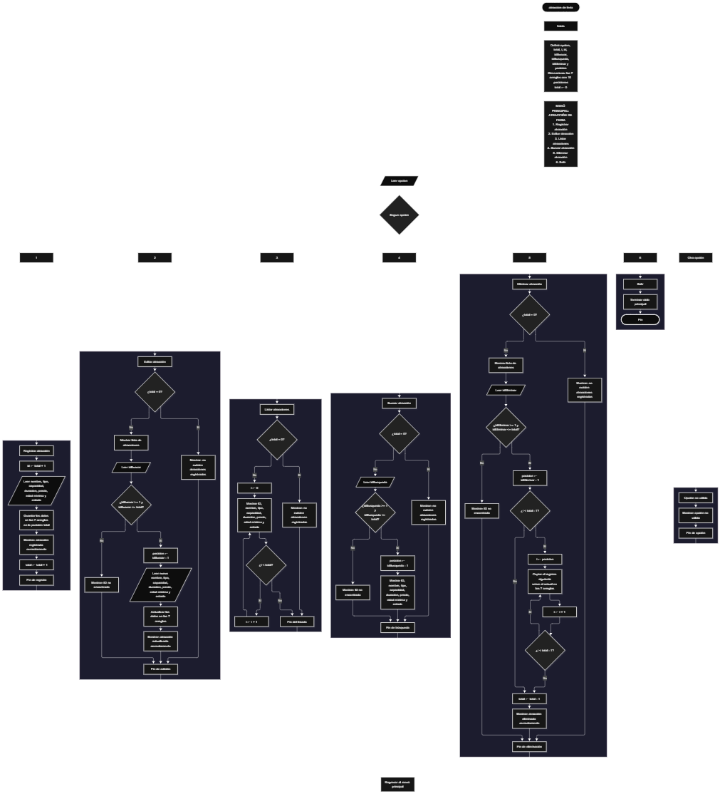

Este proyecto, llamado <b>atracción de feria</b>, fue desarrollado en <b>Java</b> como un ejercicio práctico para fortalecer la lógica de programación mediante la creación de un sistema de gestión de atracciones desde la consola. El programa cuenta con un menú principal de seis opciones que permite <b>registrar, editar, listar, buscar y eliminar</b> las atracciones registradas, además de finalizar la ejecución del sistema. Cada atracción almacena datos como el nombre, el tipo, la capacidad de personas, la duración del recorrido, el precio del boleto, la edad mínima permitida y el estado de la atracción, utilizando arreglos con una capacidad máxima de <b>10 registros durante la ejecución</b>. Durante su desarrollo se aplicaron conceptos fundamentales de programación, como variables, arreglos, estructuras condicionales, ciclos repetitivos y estructuras de selección, además de procesos para buscar, modificar, eliminar y organizar registros. Este proyecto permite poner en práctica los conocimientos adquiridos en Java y sirve como base para desarrollar sistemas de gestión más avanzados utilizando otros lenguajes y tecnologías.

<h2 align="center">⚙️ Funcionamiento del menú principal</h2>

### ➕ Registrar atracción

La opción <b>1) registrar atracción</b> permite agregar una nueva atracción al sistema. Antes de realizar el registro, el programa calcula el identificador mediante la expresión <b>id = total + 1</b>, utilizando la variable <b>total</b> para determinar la siguiente posición disponible. Después, solicita el <b>nombre, tipo, capacidad de personas, duración del recorrido, precio del boleto, edad mínima permitida y estado</b> de la atracción. Los datos se almacenan en la posición correspondiente de sus respectivos arreglos. Finalmente, muestra el mensaje <b>"Atraccion registrada correctamente."</b> y aumenta la variable <b>total</b> en uno para actualizar la cantidad de registros almacenados.

### ✏️ Editar atracción

La opción <b>2) editar atracción</b> permite modificar la información de una atracción registrada. Primero, el programa comprueba si existen atracciones almacenadas mediante la variable <b>total</b>. Si no hay registros, muestra el mensaje <b>"No existen atracciones registradas."</b>. En caso contrario, presenta una lista con el ID, nombre, tipo, capacidad, duración, precio, edad mínima y estado de cada atracción. Después, solicita el ID de la atracción que se desea editar y comprueba que esté dentro del rango permitido mediante la condición <b>idBuscar &gt;= 1 &amp;&amp; idBuscar &lt;= total</b>. Si la selección es válida, calcula la posición mediante <b>posicion = idBuscar - 1</b> y solicita los nuevos datos de la atracción, actualizando directamente los valores de los siete arreglos correspondientes. Finalmente, presenta el mensaje <b>"Atraccion actualizada correctamente."</b>. Si el ID seleccionado no corresponde a una atracción registrada, muestra el mensaje <b>"ID no encontrada."</b>.

### 🗑️ Eliminar atracción

La opción <b>5) eliminar atracción</b> permite eliminar una atracción registrada mediante su ID. Antes de comenzar, el programa comprueba que existan atracciones almacenadas. Si no hay registros, muestra el mensaje <b>"No existen atracciones registradas."</b>. Si hay atracciones disponibles, presenta una lista con la información de cada registro. Después, solicita el ID de la atracción que se desea eliminar y verifica que la selección esté dentro del rango válido mediante la condición <b>idEliminar &gt;= 1 &amp;&amp; idEliminar &lt;= total</b>. Si la atracción existe, calcula su posición mediante <b>posicion = idEliminar - 1</b> y comienza el proceso de eliminación. Para mantener los registros organizados, utiliza un ciclo <b>for</b> controlado por la variable <b>i</b>, que desplaza una posición hacia atrás los datos de las atracciones posteriores en los siete arreglos: <b>nombres, tipos, capacidades, duraciones, precios, edadesMinimas y estados</b>. Posteriormente, disminuye la variable <b>total</b> en uno y muestra el mensaje <b>"Atraccion eliminada correctamente."</b>. Si el ID seleccionado no corresponde a una atracción registrada, presenta el mensaje <b>"ID no encontrada."</b>.

### 🔎 Buscar atracción

La opción <b>4) buscar atracción</b> permite localizar una atracción mediante su ID. Primero, el programa comprueba si existen atracciones registradas. Si no hay registros, muestra el mensaje <b>"No existen atracciones registradas."</b>. En caso contrario, solicita el ID de la atracción que se desea buscar y comprueba que esté dentro del rango permitido mediante la condición <b>idBusqueda &gt;= 1 &amp;&amp; idBusqueda &lt;= total</b>. Si el ID es válido, calcula la posición correspondiente mediante <b>posicion = idBusqueda - 1</b> y muestra los datos completos de la atracción encontrada: <b>nombre, tipo, capacidad, duración, precio, edad mínima y estado</b>. Si el ID introducido no corresponde a ninguna atracción registrada, presenta el mensaje <b>"ID no encontrada."</b>.

### 📋 Listar atracciones

La opción <b>3) listar atracciones</b> permite visualizar todas las atracciones registradas actualmente en el sistema. Antes de mostrar la información, el programa comprueba si la variable <b>total</b> es igual a cero. Si no existen registros, presenta el mensaje <b>"No existen atracciones registradas."</b>. Si hay atracciones disponibles, utiliza un ciclo <b>for</b> para recorrer los arreglos desde la primera posición hasta el número total de atracciones registradas. Durante el recorrido, muestra el ID, nombre, tipo, capacidad de personas, duración del recorrido, precio del boleto, edad mínima permitida y estado de cada atracción. Esta función facilita consultar los registros existentes sin necesidad de buscar cada atracción individualmente.

### 🚪 Salir del menú principal

La opción <b>6) salir</b> está destinada a finalizar la ejecución del programa y muestra el mensaje <b>"Gracias por utilizar Atraccion de Feria."</b>. El menú principal se encuentra dentro de una estructura repetitiva <b>do-while</b>, que mantiene el programa en funcionamiento mientras la variable <b>opcion</b> sea diferente de <b>6</b>. Cuando el usuario selecciona esta opción, la condición <b>opcion != 6</b> deja de cumplirse y el ciclo finaliza. Finalmente, se utiliza <b>entrada.close()</b> para cerrar el objeto Scanner y terminar correctamente la ejecución del programa.

<h2 align="center">🧠 Temas aplicados en el proyecto</h2>

### 📦 Variables

En este proyecto se utilizan variables para almacenar la opción seleccionada en el menú, controlar la cantidad de atracciones registradas, generar los identificadores, recorrer los arreglos, seleccionar las atracciones que se desean editar, buscar o eliminar y determinar la posición correspondiente de cada registro. Cada variable cumple una función específica dentro de las operaciones de gestión de atracciones.

🔢 **Opcion:** Almacena la opción seleccionada por el usuario en el menú principal.

📊 **Total:** Almacena la cantidad actual de atracciones registradas.

🆔 **Id:** Calcula el identificador de la nueva atracción mediante la expresión `total + 1`.

🔄 **I:** Funciona como contador en los ciclos `for` y permite recorrer los arreglos y reorganizar los registros durante la eliminación.

✏️ **IdBuscar:** Almacena el identificador de la atracción que se desea editar.

🔎 **IdBusqueda:** Almacena el identificador de la atracción que se desea buscar.

🗑️ **IdEliminar:** Almacena el identificador de la atracción que se desea eliminar.

📍 **Posicion:** Determina la posición del registro dentro de los arreglos mediante la resta del ID menos uno.

### 🗃️ Arreglos

En este proyecto se utilizan siete arreglos relacionados con los datos de cada atracción. Cada arreglo tiene una capacidad de <b>10 posiciones</b> y utiliza el mismo índice para representar la información correspondiente a una misma atracción. Por ejemplo, los datos de una atracción almacenada en la posición <b>0</b> se encuentran distribuidos entre <b>nombres[0], tipos[0], capacidades[0], duraciones[0], precios[0], edadesMinimas[0] y estados[0]</b>. Esta organización permite recorrer, buscar, modificar, mostrar y eliminar las atracciones de manera ordenada.

🎢 **Nombres[10]:** Almacena los nombres de las atracciones registradas.

🎡 **Tipos[10]:** Almacena los tipos de atracción.

👥 **Capacidades[10]:** Almacena la cantidad máxima de personas permitidas en cada atracción.

⏱️ **Duraciones[10]:** Almacena la duración del recorrido en minutos.

💰 **Precios[10]:** Almacena los precios de los boletos de cada atracción.

🔞 **EdadesMinimas[10]:** Almacena las edades mínimas permitidas para utilizar cada atracción.

⚙️ **Estados[10]:** Almacena el estado actual de cada atracción.

### 🔀 Estructuras condicionales

En este proyecto se utiliza la estructura <b>if-else</b> para comprobar si existen atracciones registradas antes de realizar determinadas operaciones y verificar que el ID introducido por el usuario corresponda a una atracción almacenada. Estas condiciones permiten que el programa responda de manera diferente según la cantidad de registros disponibles y el resultado de cada validación. También se utiliza la estructura <b>switch-case</b> para controlar las opciones del menú principal y ejecutar la operación correspondiente.

### 🔄 Estructuras repetitivas

En este proyecto se utilizan los ciclos <b>for</b> y <b>do-while</b>. Los ciclos <b>for</b> permiten recorrer los arreglos para mostrar las atracciones registradas y presentar sus datos durante las operaciones de edición y eliminación. Durante la eliminación, también se utilizan para desplazar los datos de las atracciones posteriores una posición hacia atrás. Por otro lado, el ciclo <b>do-while</b> mantiene activo el menú principal para que el usuario pueda ejecutar diferentes operaciones antes de seleccionar la opción de salida.

### 🎯 Estructura según

El programa utiliza la estructura <b>switch</b> para evaluar el valor almacenado en la variable <b>opcion</b> y ejecutar el bloque de instrucciones correspondiente. Cada caso representa una operación específica del sistema: <b>registrar, editar, listar, buscar, eliminar o salir</b>. También se utiliza el bloque <b>default</b> para mostrar el mensaje <b>"Opcion no valida."</b> cuando el usuario introduce un número que no coincide con ninguna de las opciones definidas en el menú.

### 🔢 Dimensionamiento de arreglos

El programa utiliza la creación de arreglos mediante la instrucción <b>new</b> para establecer la capacidad de almacenamiento de los datos de las atracciones. Se definieron <b>10 posiciones</b> para cada uno de los siete arreglos, lo que permite administrar hasta 10 registros durante la ejecución. La cantidad de posiciones ocupadas se controla mediante la variable <b>total</b>, por lo que las operaciones recorren únicamente los registros comprendidos entre la primera posición y el total actual de atracciones.

### 🔄 Reorganización de registros

Cuando se selecciona una atracción para eliminarla, el programa utiliza un ciclo <b>for</b> que comienza en la posición seleccionada y llega hasta <b>total - 1</b>. En cada repetición, los datos de la posición siguiente se copian sobre la posición actual en los siete arreglos: <b>nombres, tipos, capacidades, duraciones, precios, edadesMinimas y estados</b>. Después, la variable <b>total</b> disminuye en uno para actualizar la cantidad de registros activos. De esta manera, las atracciones posteriores ocupan las posiciones disponibles sin dejar espacios vacíos entre los registros activos.

<h2 align="center">¿Cómo se implementaron las operaciones crud en el proyecto?</h2>

Las operaciones <b>CRUD</b> se implementaron mediante las opciones del menú principal, permitiendo administrar las atracciones registradas. La operación <b>crear</b> corresponde a <b>registrar atracción</b>, donde se introducen los datos de una nueva atracción; <b>leer</b> se realiza mediante las opciones <b>buscar atracción y listar atracciones</b>; <b>actualizar</b> corresponde a <b>editar atracción</b>, donde se modifican los datos de una atracción registrada; y <b>eliminar</b> se realiza mediante la opción <b>eliminar atracción</b>. Estas operaciones utilizan variables, arreglos, condicionales y ciclos para gestionar la información almacenada temporalmente durante la ejecución del programa.

<h2 align="center">Diagrama de flujo del proyecto</h2>

<h2 align="center">🛡️ Validaciones del programa</h2>

### 📭 No existen atracciones registradas

Esta validación se utiliza en las opciones de <b>editar, eliminar, buscar y listar</b>. El programa comprueba si la variable <b>total</b> es igual a <b>0</b> y, si no existen atracciones registradas, muestra el mensaje <b>"No existen atracciones registradas."</b>. Esta comprobación evita continuar con las operaciones que necesitan información almacenada cuando no hay registros disponibles.

### 🔢 Selección de atracciones

El programa utiliza las variables <b>idBuscar, idBusqueda e idEliminar</b> para identificar la atracción que se desea editar, buscar o eliminar. Antes de realizar estas operaciones, comprueba que el ID introducido sea mayor o igual a <b>1</b> y menor o igual al valor de <b>total</b>. Si la selección está fuera de ese rango, muestra el mensaje <b>"ID no encontrada."</b>. Esta validación evita modificar, buscar o eliminar posiciones que no corresponden a atracciones registradas.

### ⚠️ Capacidad de los arreglos

Los siete arreglos del programa tienen una capacidad fija de <b>10 registros</b>. Sin embargo, el código actual no incluye una validación que compruebe si los arreglos están llenos antes de registrar una nueva atracción. Por este motivo, si se intenta registrar una atracción cuando ya existen 10 registros, el programa puede generar un error de índice fuera de los límites del arreglo. Esta es una validación que podría incorporarse posteriormente para controlar la capacidad máxima del sistema.

### ❌ Opción inválida

La estructura <b>switch</b> incluye el bloque <b>default</b>, que muestra el mensaje <b>"Opcion no valida."</b> cuando el usuario introduce un número que no corresponde a ninguna de las opciones definidas en el menú. De esta manera, el programa informa que la selección realizada no es válida y permite continuar utilizando las opciones disponibles.

<h2 align="center">🎯 Objetivo del proyecto</h2>

El objetivo principal de este proyecto es fortalecer la <b>lógica de programación</b> mediante el desarrollo de un sistema de gestión de atracciones de feria en <b>Java</b>. A través de su construcción se busca aplicar los conocimientos adquiridos sobre variables, arreglos, estructuras condicionales, ciclos repetitivos y estructuras de selección, integrándolos para resolver un problema de manera organizada. Además, el proyecto permite comprender cómo registrar, consultar, modificar y eliminar información en una aplicación de consola, estableciendo una base para desarrollar sistemas de gestión más completos con otros lenguajes y tecnologías.

